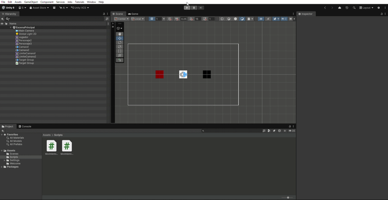
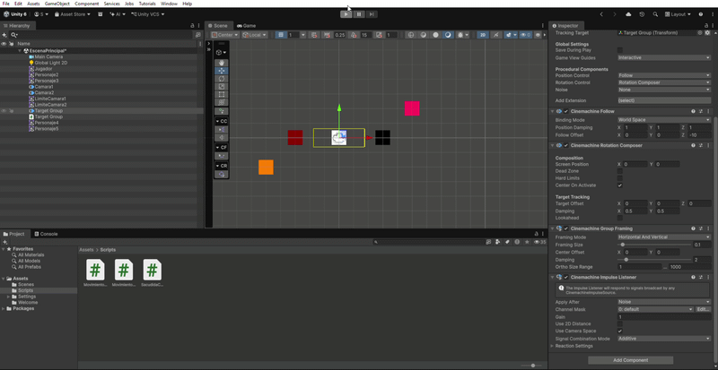
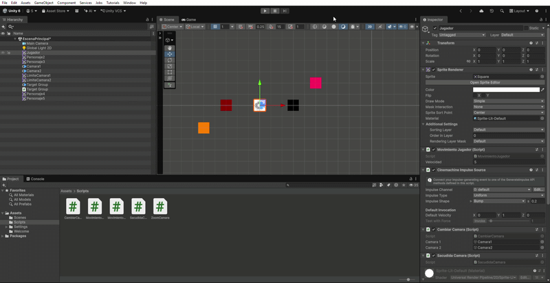
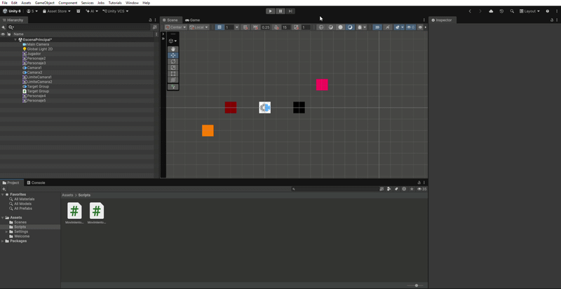
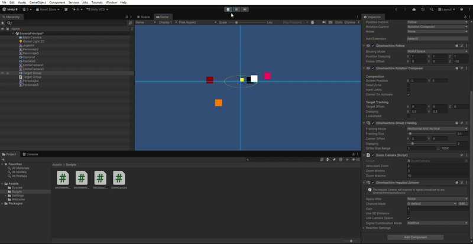
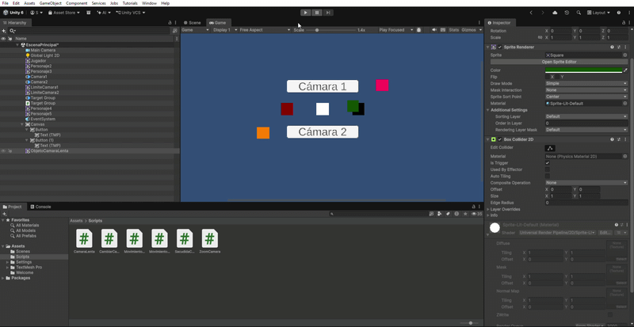
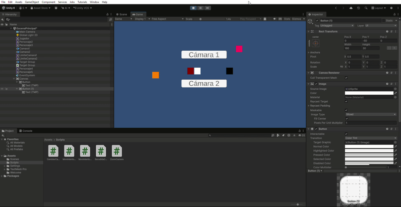
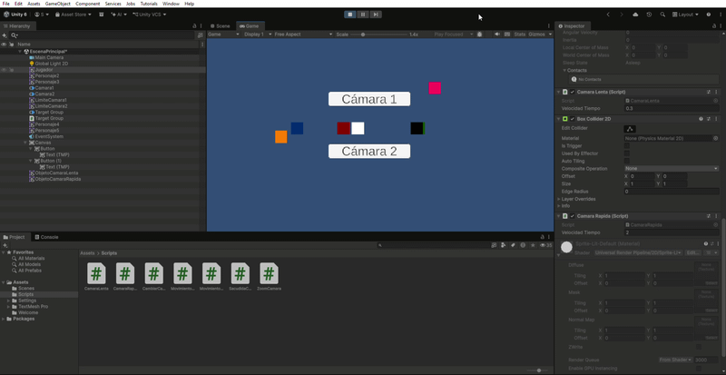

# Práctica: Cinemachine 2D

## Introducción

En esta práctica se han realizado diferentes ejercicios utilizando Unity y Cinemachine 2D para aprender a configurar cámaras, seguir personajes, controlar el zoom y modificar el comportamiento de la cámara mediante scripts y colisiones.

## Ejercicios realizados

### Ejercicio 1. Cámaras con diferentes zonas de seguimiento
Creación y configuración de dos cámaras con diferentes zonas de seguimiento para observar cómo cambia la vista según la posición del jugador.

### Ejercicio 2. Límites de cámara
Configuración de límites mediante Cinemachine Confiner 2D para restringir el movimiento de la cámara a determinadas zonas.

### Ejercicio 3. Seguimiento de varios personajes
Configuración de una cámara para seguir a varios personajes en movimiento y mantenerlos dentro de la vista.

### Ejercicio 4. Target Group y ponderaciones
Incorporación de más personajes al Target Group y modificación de sus pesos para controlar la importancia de cada uno en el encuadre.

### Ejercicio 5. Sacudida de cámara
Utilización de Cinemachine Impulse para provocar una sacudida de cámara al pulsar la barra espaciadora.

### Ejercicio 6. Control del zoom
Creación de un script para acercar y alejar la cámara mediante las teclas W y S, estableciendo límites de zoom.

### Ejercicio 7. Cambio entre cámaras mediante teclado
Creación de un script para activar y desactivar dos cámaras utilizando las teclas 1 y 2.

### Ejercicio 8. Selección de cámara mediante interfaz
Creación de una interfaz con dos botones que permiten seleccionar cuál de las dos cámaras está activa.

### Ejercicio 9. Cámara lenta
Creación de un sistema que reduce la velocidad del juego cuando el jugador entra en contacto con un objeto determinado.

### Ejercicio 10. Velocidad rápida
Creación de un sistema que aumenta la velocidad del juego cuando el jugador colisiona con otro objeto.

### Ejercicio 11. Activación y desactivación del Confiner
Creación de un sistema que permite activar y desactivar los límites de la cámara al entrar en contacto con un objeto.

## Tecnologías utilizadas

- Unity
- C#
- Cinemachine 2D
- Cinemachine Confiner 2D
- Cinemachine Impulse
- TextMeshPro
